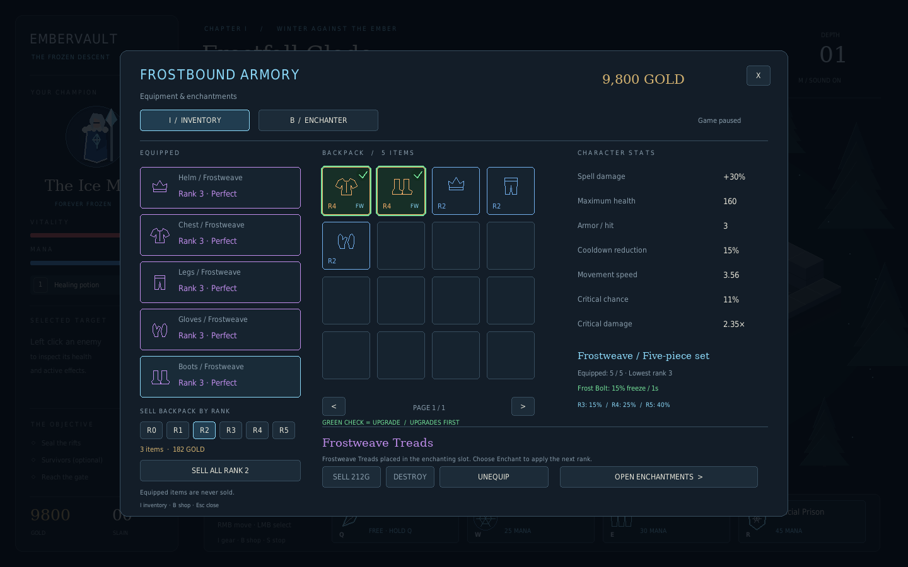

# Embervault — Thornveil Forest

A Python 3.14 desktop action dungeon crawler inspired by Gauntlet and Diablo.
Play a female Ice Mage in Frostfall Glade: move with the mouse, control crowds
with ice, collect ranked equipment, enchant it, and destroy three molten rifts
to enter level 2: Thornveil Forest, with cursed trees, spiders, and skeletal archers.





## Install or update

Install [Git](https://git-scm.com/downloads) and
[uv](https://docs.astral.sh/uv/getting-started/installation/).
For a new checkout:

```sh
git clone --branch work https://github.com/jimmysharrrison/Test_Project.git
cd Test_Project
uv run main.py
```

If you already cloned the `work` branch, close the game and run these commands
from its folder:

```sh
git pull --ff-only
uv run main.py
```

On Windows, the project folder in the current setup is `C:\Projects\Test_Project`.
uv selects Python 3.14.8 and installs the locked Pygame CE dependency. A graphical
desktop is required for interactive play. Press **Enter** or click **Begin
Descent** on the title screen.

## Controls

| Control | Action |
| --- | --- |
| Right click | Find a path to the clicked floor position |
| Hold right mouse button | Continually follow the cursor, routing around obstacles |
| Left click an enemy or rift | Select it; inspect health and active effects |
| Left click empty ground | Clear selection |
| Q / hold Q | Cast / repeat Ice Bolt toward the cursor |
| W | Cast Frost Nova around the mage |
| E | Place Ice Wall at the cursor |
| R | Enter Glacial Prison |
| Left click a spell button | Cast a self spell, or arm an aimed spell |
| Left click ground after arming Q or E | Confirm the aimed spell |
| Right click / Escape while aiming | Cancel aiming |
| 1 / click the potion button | Use a healing potion |
| S | Stop moving |
| Escape | Pause / resume |
| M | Mute / unmute effects |
| I / click Gear | Open or close inventory |
| B | Open or close the shop and enchanter |
| Enter / click the end-screen button | Continue to the next depth, or restart after death |

Left click selects enemies; it never performs an automatic attack. A selection
does not redirect skill shots. Q aims where the cursor is pointing. Ice Wall's
placement preview appears when its button is clicked; red tiles explain an
invalid placement. Clicking a disabled spell reports why it cannot be cast.

WASD and left-click attacks from the Warden prototype have been replaced. E and R
are now spells; healing moved to 1 and restarting moved to Enter.

## Ice Mage spells

| Key | Spell | Effect | Mana | Cooldown |
| --- | --- | --- | --- | --- |
| Q | Ice Bolt | 24 damage; chills movement by 40% for 2 seconds | 0 | 0.35s |
| W | Frost Nova | 14 damage within 2.8 tiles; freezes movement and attacks for 2.25 seconds | 25 | 8s |
| E | Ice Wall | Three-tile barrier lasting 6 seconds; blocks characters and projectiles | 30 | 14s |
| R | Glacial Prison | Stationary and immune to damage for 2.5 seconds; shatters for 90 damage within 3.2 tiles and freezes survivors for 2 seconds | 45 | 45s |

Spell values in the table are base values before equipment and critical hits.
Mana regenerates at 8 per second, up to 100. Quick spells briefly interrupt
movement, then the current movement order resumes. Glacial Prison prevents
casting and potion use while encased; its explosion happens automatically.
Walls block area effects as well as projectiles. Cooldowns and effect timers
freeze while the game is paused.

Ice Wall has a range of 5 tiles. Placement cannot overlap walls, characters,
rifts, or the gate, and cannot seal off a reachable part of the map. Both the
mage and enemies update their routes when a wall appears or melts. Clicking an
unreachable position chooses nearby reachable floor.

The target frame shows real health and timed freeze/chill effects. Current
enemies have no mana resource; no decorative mana bar is shown for them. Damage
over time spells and further buff types are future work.

## Equipment and enchantments

Press **I** to inspect Helm, Chest, Legs, Gloves, and Boots, or **B** to visit the
enchanter. Both menus pause combat. Hover an item for its stats, rank, and next
enchantment price. Click a backpack item and then **Equip Item**; click an
already-equipped item and **Unequip** to return it to the backpack.

Select a spare item and click **Sell** for the displayed gold amount, or
**Destroy** to remove it without payment. Destruction asks for confirmation;
**Cancel** or **Escape** keeps the item. Equipped gear must be unequipped first.
Sell values also appear in item tooltips. Sales and removals save with your
character, and the selected item can be sold or destroyed from either menu.

- Helm increases all spell damage; chest increases maximum health.
- Legs add armor that reduces incoming hits; gloves shorten newly cast cooldowns.
- Boots add movement speed, critical chance, and critical damage. They are the
  rarest random drop and a guaranteed Rank 1 reward for clearing level 1.
- Dropped equipment is Rank 1–3. Rank 3 has the best dropped stats.
- The shop sells blank Rank 0 items. Enchant them one rank at a time through
  Rank 5. The final upgrade costs **15,000 gold**.
- Items fill empty slots automatically. Other pieces go into the paged backpack.
- Maximum health increases do not heal you; use food or potions to fill it.

See [the full equipment and economy tables](docs/EQUIPMENT.md) for every bonus,
price, and drop rate. The menu displays your current effective character stats.

## Progression and presentation

Destroy all three rifts to complete the level and open the gate. Surviving
monsters are optional. Remaining equipment and gold are banked on the clear.
Reach the gate, then press Enter to continue. Gear and gold carry into the next
depth. Health and mana refill, and spell cooldowns reset between depths.

**Level 1 — Frostfall Glade** keeps the original Molten Skeletons, Ember
Skitters, and Molten Rifts. **Level 2 — Thornveil Forest** has a different layout,
mossy earth, tree obstacles, roots, mushrooms, and drifting green wisps. Darkroot
Treants replace the skeletons, Thornwood Spiders replace the skitters, and
Briarbone Archers add ranged pressure. Destroy three **Blighted Hearts** to
open the forest portal; surviving monsters remain optional.

| Forest enemy | Level 2 health | Damage before armor | Behavior |
| --- | --- | --- | --- |
| Darkroot Treant | 51 | 11 | Slow melee attacker animated by dark magic |
| Thornwood Spider | 30 | 7 | Fast melee attacker |
| Briarbone Archer | 39 | 9 | Keeps its distance and periodically fires arrows |

Archers show a dotted aim line during a **0.65-second bow draw**. Aim locks when
the draw begins, so moving sideways can dodge the arrow. A shot travels at 5.5
tiles per second, followed by a 2.8-second cooldown before the next draw. Terrain
and Ice Wall block arrows; freeze interrupts a bow draw, and Glacial Prison
absorbs incoming arrows. Armor and the shared brief protection after taking a
hit apply to arrow damage too. Archers navigate around blocked sight lines.

Depths 3 onward currently reuse the forest with stronger enemies and higher
gold rewards. Each additional depth adds 15% to base enemy/spawner health and
gold, and 12% to base attack damage. To try the forest immediately without
changing your saved character, run `uv run main.py --level 2 --no-save`.

Gold and equipment can be collected on contact before the clear. Food heals
injured players. Potions restore up to 40 health, respect your equipped maximum
health, and are not consumed at full health.

The local character saves equipment, enchantments, gold, potions, kills, and
unlocked depth automatically. On Windows the save is in
`%LOCALAPPDATA%\Embervault\profile.json`. A new session starts a fresh room at
the highest unlocked depth. Use `uv run main.py --no-save` for a temporary
character, or `--profile PATH` to choose another save file. Profile errors appear
in-game; an invalid profile is preserved instead of being overwritten.

The visual direction follows the written prompts in the recent **Ice Mage Game
Art** chat: a blue-and-silver female mage, pale fur collar, an original “forever
frozen” glyph, molten demonic skeletons, and a dark forest setting. This build
uses original procedural artwork and synthesized sound. The generated reference
image files were not available through the chat reader. Detailed animated
sprites and final environmental art remain future work.

Below 35% of maximum health, a dark red vignette grows around the screen edges.
It strengthens as health falls and clears when healed above the threshold. The
center, HUD, and menus remain readable; chest bonuses count toward maximum health.

The game pauses on focus loss and supports resizing with a fixed aspect ratio.
Sound falls back to silence when no audio device is available.

## Verification

```sh
uv run python -m unittest discover -s tests -v
uv run python -m compileall -q dungeon main.py text_game.py
uv run main.py --headless --frames 120 --seed 7 --screenshot preview.png
```

The last command uses a virtual display and starts immediately; it works in a
headless environment. `--frames` exits after the given frame count.

## Code layout

- `dungeon/items.py`: ranked equipment, character bonuses, drop values, and prices.
- `dungeon/armory.py`: inventory, item tooltips, backpack pages, and enchanting UI.
- `dungeon/profile.py`: local character saves.
- `dungeon/abilities.py`: spell definitions and initial balance values.
- `dungeon/levels.py`: chapter themes, distinct layouts, and enemy rosters.
- `dungeon/controls.py`: mouse orders, button targeting, and hotkey casting.
- `dungeon/navigation.py`: reachable destinations and smoothed grid paths.
- `dungeon/world.py`: collision, spells, effects, enemies, spawning, and progression.
- `dungeon/render.py`: procedural art, target frame, ability buttons, and previews.
- `dungeon/audio.py`: synthesized spell and combat cues.
- `dungeon/app.py`: desktop events, viewport conversion, pause, and restart.
- `tests/`: simulation, controls, desktop input, and original-game regression tests.

The original text prototype remains available with `uv run main.py --text`.
See [GAME_DESIGN.md](GAME_DESIGN.md) for the direction and later milestones.
