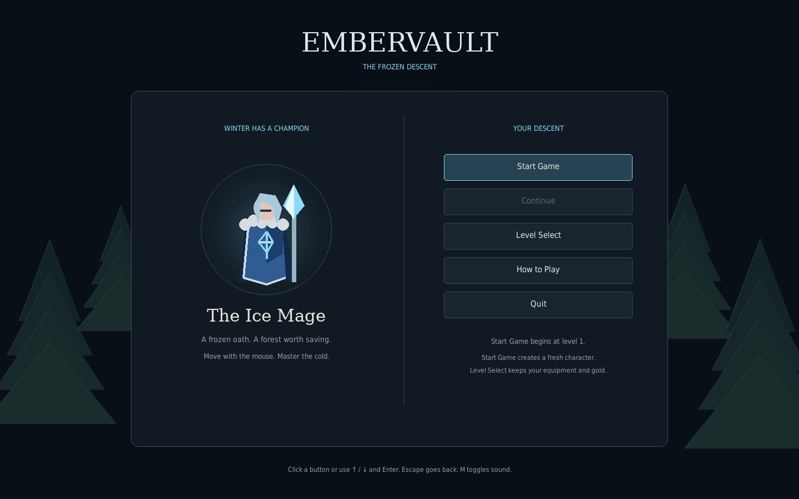
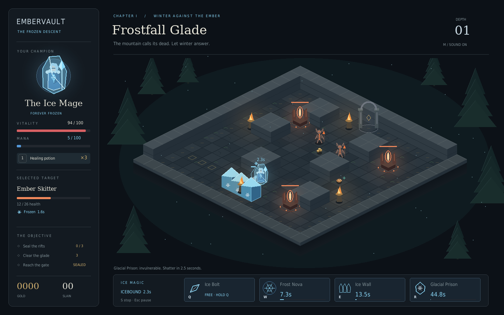
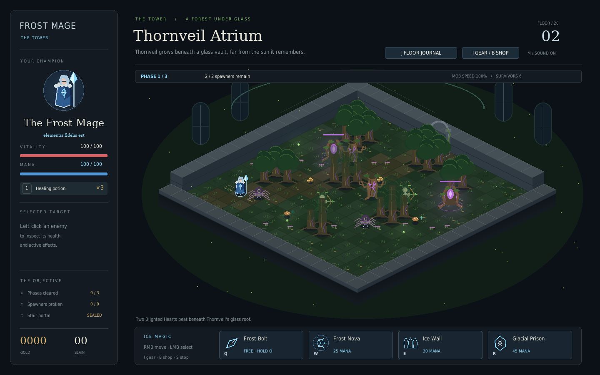
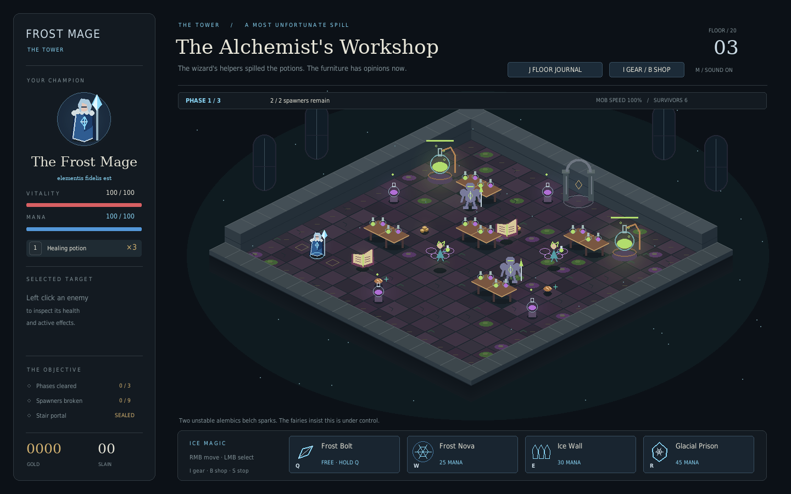
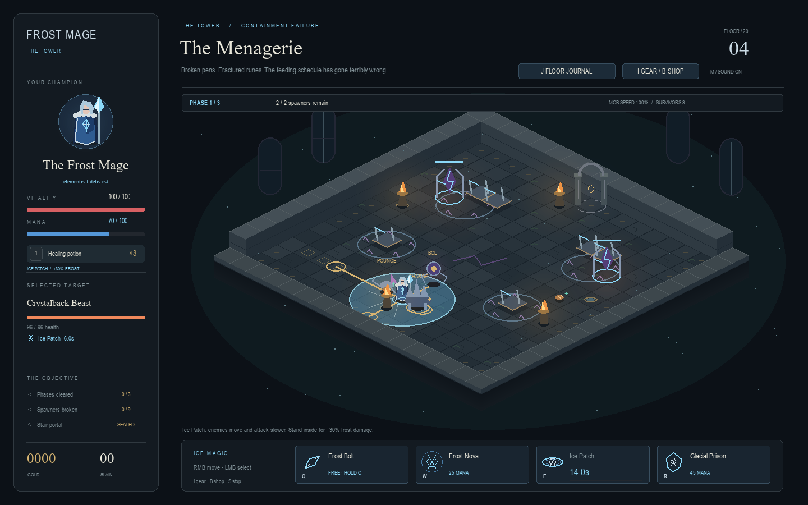

# Frost Mage

Normal play now records local playthrough logs automatically. After playing,
close the game and upload the newest ZIP from `C:\Projects\Test_Project\logs`.
Each bundle contains readable summaries and detailed combat events for balance
review. Nothing is uploaded automatically. See [playthrough logging](docs/TELEMETRY.md)
for contents, crash recovery and the `--no-telemetry` option.

A Python 3.14 desktop action dungeon crawler inspired by Gauntlet and Diablo.
An as-yet nameless wanderer, trained at Drearamore's elemental college, arrives
at **The Tower**. She carries its motto, **elementis fidelis est**, into a
twenty-story mystery. This build completes the first five-floor section: a stone entrance hall, an
indoor forest atrium, a chaotic alchemy workshop, the escaped specimens of the
Menagerie, and the lower tower's furious caretaker, the Keeper. Fifteen upper
floors remain unexplored.









## Install or update

Install [Git](https://git-scm.com/downloads) and
[uv](https://docs.astral.sh/uv/getting-started/installation/).
For a new checkout:

```sh
git clone --branch work https://github.com/jimmysharrrison/Test_Project.git
cd Test_Project
uv run main.py
```

If you already cloned the `work` branch, close the game and run these commands
from its folder:

```sh
git pull --ff-only
uv run main.py
```

On Windows, the project folder in the current setup is `C:\Projects\Test_Project`.
uv selects Python 3.14.8 and installs the locked Pygame CE dependency. A graphical
desktop is required for interactive play. Every normal launch opens the title
menu and waits for your choice; combat does not run behind it.

## Title menu and starting over

- **Start Game** begins a fresh Frost Mage on the ground floor. If a character exists, a
  confirmation explains that starting over replaces its gear, gold, and unlocks.
- **Continue** resumes your current level with your saved character. A fresh
  room is loaded after reopening the app; returning from the pause menu keeps
  the current room. Continue is disabled until a character exists.
- **Level Select** replays any reached level while keeping equipment and gold.
  A destination unlocks only after you enter it through the preceding portal.
  Replaying level 1 retains previously earned unlocks. New characters start
  with only level 1 available.
- **How to Play** explains mouse movement, targeting, spells, healing, gear,
  and portal progression. It is also available from the pause menu.
- **The Story** introduces the wanderer, Drearamore, and The Tower. **J** opens
  the current floor's journal, including its story and three encounter phases.
- **Quit** closes the game. Merely browsing menus does not create a character.

Click buttons, or use **Up / Down** and **Enter**. Press **Escape** in game,
then **Main Menu**, to return to the title screen and start over or select a
level. The game stays paused while you read instructions or browse levels.

## Controls

| Control | Action |
| --- | --- |
| Right click | Find a path to the clicked floor position |
| Hold right mouse button | Continually follow the cursor, routing around obstacles |
| Left click an enemy or rift | Select it; inspect health and active effects |
| Left click empty ground | Clear selection |
| Q / hold Q | Cast / repeat Frost Bolt toward the cursor |
| W | Cast Frost Nova around the mage |
| E | Place Ice Patch at the cursor |
| R | Enter Glacial Prison |
| Left click a spell button | Cast a self spell, or arm an aimed spell |
| Left click ground after arming Q or E | Confirm the aimed spell |
| Right click / Escape while aiming | Cancel aiming |
| 1 / click the potion button | Use a healing potion |
| S | Stop moving |
| Escape | Pause / resume |
| M | Mute / unmute effects |
| I / click Gear | Open or close inventory |
| B | Open or close the shop and enchanter |
| J / click Floor Journal | Read the floor's story and phase objectives; combat pauses |
| Enter / click the end-screen button | Climb to the next floor, retry after death, or return to title at chapter end |
| Up / Down + Enter | Navigate title, level, instructions, and pause menus |

Left click selects enemies; it never performs an automatic attack. A selection
does not redirect skill shots. Q aims where the cursor is pointing. Ice Patch's
circular placement preview appears when its button is clicked; red marks an
invalid placement. Clicking a disabled spell reports why it cannot be cast.

WASD and left-click attacks from the Warden prototype have been replaced. E and R
are now spells; healing moved to 1 and restarting moved to Enter.

## Frost Mage spells

| Key | Spell | Effect | Mana | Cooldown |
| --- | --- | --- | --- | --- |
| Q | Frost Bolt | 24 damage; chills movement by 40% for 2 seconds | 0 | 0.35s |
| W | Frost Nova | 14 damage within 2.8 tiles; freezes movement and attacks for 2.25 seconds | 25 | 8s |
| E | Ice Patch | 6s ground field, 2.4-tile radius; enemies move 50% slower and attack 40% slower; mage gains 30% frost damage inside | 30 | 14s |
| R | Glacial Prison | Stationary and immune to damage for 2.5 seconds; shatters for 90 damage within 3.2 tiles and freezes survivors for 2 seconds | 45 | 45s |

Spell values in the table are base values before equipment and critical hits.
Mana regenerates at 6 per second, up to 100. Tune with `--mana-regen 6`
(or `--mana-regen 8` for the previous balance). See [mana balance measurements](docs/MANA_BALANCE.md). Quick spells briefly interrupt
movement, then the current movement order resumes. Glacial Prison prevents
casting and potion use while encased; its explosion happens automatically.
Walls block area effects as well as projectiles. Cooldowns and effect timers
freeze while the game is paused.

Ice Patch has a range of 5 tiles and can be placed under the mage or enemies.
Its center needs clear floor and line of sight. The field remains walkable and
projectiles pass through it. Enemies regain normal movement and attack rates
when they leave or the six seconds expire. Overlapping patches do not stack;
Frost Bolt's chill multiplies with the field's movement slow. The mage keeps
normal movement and cooldowns. The +30% bonus is captured when Frost Bolt,
Frost Nova or Glacial Prison is cast from inside, including bolts or shatters
that land after the mage leaves or the patch expires. Stone terrain still
blocks movement and shots. Clicking unreachable ground chooses nearby floor.

The target frame shows real health and timed frost/patch effects. Current
enemies have no mana resource; no decorative mana bar is shown for them. Damage
over time spells and further buff types are future work.

## Equipment and enchantments

Press **I** to inspect Helm, Chest, Legs, Gloves, and Boots, or **B** to visit the
enchanter. Both menus pause combat. Hover an item for its stats, rank, and next
enchantment price. Click a backpack item and then **Equip Item**; click an
already-equipped item and **Unequip** to return it to the backpack.

The catalog contains **25 templates**: 20 ordinary pieces and five Frostweave pieces.
Ordinary gear has one rolled enchantment and caps at Rank 3. Reach floor 3 to
enchant to Rank 2 and floor 5 to enchant to Rank 3. The first Keeper victory
awards a Rank 3 Frostweave Crown and unlocks Rank 3 Frostweave stock and drops.
Only Frostweave can reach Ranks 4 and 5. Equip all five set pieces to give
**Q / Frost Bolt** a chance to freeze a surviving enemy for **1 second**:

| Lowest equipped Frostweave rank | Freeze chance per hit |
| --- | ---: |
| 3 | 15% |
| 4 | 25% |
| 5 | 40% |

The lowest-ranked piece determines the set tier. Backpack pieces do not count.
Missing a piece, wearing non-set gear, or dropping below Rank 3 disables the
bonus. Item tooltips explain the set, character stats show its progress, and
the Frost Bolt tooltip shows the active chance. Enchanting preserves set
membership, and the set identity saves with the character. Ordinary equipment
stays ordinary when enchanted; the original random-roll quality is preserved.
See the [Frostweave freeze preview](docs/frostweave-freeze.png).

On the enchanter page, drag worn or backpack gear into the **Enchanting Slot**,
then click **Enchant** for the displayed gold cost. Dropping into the slot does
not spend gold, unequip the item, or remove it from the backpack. The slot keeps
its target when you select other gear. **Place Selected Item** is an alternative
to dragging; **Clear Slot** removes the target. New purchases enter the slot
automatically. You can also start a drag in inventory and hover the Enchanter
tab before dropping. Escape or focus loss cancels a drag; dropping elsewhere
keeps the item. The shop backpack supports paging through all owned spares.
See the [enchanter preview](docs/enchanter.png).

Older shop blanks are recognized automatically. Previously enchanted items
without set metadata keep their existing identity: the old format no longer
records whether those items originally came from the shop or a drop.

Backpack upgrades have a **green border and checkmark** and appear first, with
the highest ranks first. Matching rolled templates compare their enchantment
strength; different effects are customization choices, not automatic upgrades.
Legacy fixed-stat gear compares rank; useful gear for an empty slot also counts. Markers update when equipment
or enchantments change, and upgrade tooltips explain the comparison.

Select a spare item and click **Sell** for the displayed gold amount, or
**Destroy** to remove it without payment. Individual sales of **Rank 3–5** ask
**ARE YOU SURE?** before selling. Rank 0–2 single sales remain immediate.
Destruction always asks for confirmation. **Cancel** or **Escape** keeps the
items and leaves the menu open. Equipped gear must be unequipped first.
Sell values also appear in item tooltips. Sales and removals save with your
character, and the selected item can be sold or destroyed from either menu.

For bulk cleanup, choose **R0–R5** under **Sell Backpack by Rank**, then click
**Sell All Rank N**. This sells only that exact rank across every backpack page.
Every bulk sale asks **ARE YOU SURE?**, showing the item count and total gold.
The confirmation warns if upgrades are included. Equipped items are always
kept. Switching menus cancels a pending confirmation.
See the [bulk-sale confirmation preview](docs/sell-all.png).

- Ordinary pieces specialize in damage, resources, area, defense, healing,
  cooldowns, movement, critical chance, or utility effects. See the catalog for exact ranges.
- Floors 1–2 drop Rank 1; floors 3–4 mostly Rank 1 with 10% Rank 2;
  floor 5 uses 75% / 23% / 2% for ordinary Ranks 1 / 2 / 3.
- Boots retain their rare slot roll, and the first floor awards Rank 1 Everfrost Treads.
- Before the Keeper unlock, stock is Rank 1 ordinary equipment. Afterward,
  stock is Rank 3 Frostweave; 12% of equipment drops become Rank 3 Frostweave.
- The Frostweave Rank 4 and 5 upgrades cost **2,500** and **15,000 gold** per piece.
- All 25 equipment templates use their individual transparent illustrations in
  `Images/Icons/Equipment/` in the inventory, shop, drag preview, enchanting slot,
  Codex, and ground loot. `Images/Icons/Weapons/` and `Images/Icons/Characters/`
  reserve space for future weapon and character icons. Larger generated originals
  and generation records live in `Images/Sources/Equipment/`. Images fit their
  available space without stretching; rank borders and labels stay visible.
- Items fill empty slots automatically. Other pieces go into the paged backpack.
- Maximum health increases do not heal you; use food or potions to fill it.

See [the full equipment and economy tables](docs/EQUIPMENT.md) for every bonus,
price, and drop rate. The menu displays your current effective character stats.

## Progression and presentation

Read [The Story](docs/story.png) from the title menu or press **J** for the
current floor's journal. The [phase preview](docs/phase.png) shows the countdown
and next encounter locations.

Each floor has **three phases**. Destroy the first two phases' spawners to begin
a **3-second intermission**, then the next wave or final mini-boss appears. Survivors can still
attack during the wait. The phase banner shows the countdown, remaining
spawners, and movement speed; rings preview the next spawn locations. Spawners
relocate to nearby clear floor if an actor occupies a planned spot.

| Phase | Spawners | New mob movement speed |
| --- | ---: | ---: |
| 1 | 2 | 100% |
| 2 | 3 | 115% |
| 3 | Boss and two companions | 130% |

The stair portal opens after **five spawners** and the **boss and its companions**
have fallen. Ordinary surviving monsters are optional. Gold and equipment stay
on the ground until collected or banked on portal entry. The
one-time first-floor boots arrive only after the final phase. Health, mana,
and cooldowns continue normally between phases; they reset when climbing to
the next floor. Gear, gold, potions, and kills carry forward.

**Floor 1 — The Ground Floor:** worn stone, a central inlay, and four equally
spaced load-bearing columns. Molten Skeletons and Ember Skitters emerge from
ember rifts between the pillars.

**Floor 2 — Thornveil Atrium:** the former forest is now an indoor garden under
a glass vault, surrounded by the stone walls of The Tower. Darkroot Treants,
Thornwood Spiders, and Briarbone Archers emerge from Blighted Hearts.

| Atrium enemy | Floor 2 health | Damage before armor | Behavior |
| --- | --- | --- | --- |
| Darkroot Treant | 51 | 11 | Slow melee attacker animated by dark magic |
| Thornwood Spider | 30 | 7 | Fast melee attacker |
| Briarbone Archer | 39 | 9 | Keeps its distance and periodically fires arrows |

Archers show a dotted aim line during a **0.65-second bow draw**. Aim locks when
the draw begins, so moving sideways can dodge the arrow. A shot travels at 5.5
tiles per second, followed by a 2.8-second cooldown before the next draw. Terrain
blocks arrows; freeze interrupts a bow draw, and Glacial Prison
absorbs incoming arrows. Armor and the shared brief protection after taking a
hit apply to arrow damage too. Archers navigate around blocked sight lines.

**Floor 3 — The Alchemist's Workshop:** bubbling alembics, stocked benches,
colored spills, and magic gone wrong. The wizard's little helper fairies have
spilled the potions and lost their senses, while enchanted belongings run amok.

| Workshop enemy | Floor 3 health | Damage before armor | Behavior |
| --- | ---: | ---: | --- |
| Bewitched Armor | 75 | 15 | Slow, tough melee attacker |
| Runaway Grimoire | 39 | 9 | Faster animated book |
| Potion-Maddened Fairy | 36 | 9 | Aims for 0.8s, then throws a dodgeable potion bolt |

Fairy bolts travel at 4.4 tiles/second, with 2.3 seconds between casts after
release. Terrain blocks them; freeze interrupts the cast. Each
additional floor adds 15% to base enemy/spawner health and gold, and 12% to
base attack damage. Phase speed changes apply to newly spawned mobs; survivors
keep the speed of their original phase.

Floor 3 now leads to **The Menagerie**, then **The Keeper**. His defeat completes
this five-floor section. Approach the sealed upper stair to see **To Be Continued**;
there is no playable floor 6 and the twenty-story mystery continues.
Level Select replays reached floors while preserving gear. The optional
`--level N` flag chooses a reached floor in interactive play. Headless previews
can choose any implemented floor (1–5), for example `--headless --level 3 --frames 120`.

Gold and equipment can be collected on contact before the clear. Food heals
injured players. Potions restore up to 40 health, respect your equipped maximum
health, and are not consumed at full health.

The local character saves equipment, enchantments, gold, potions, kills, current
level, and highest reached depth automatically. On Windows the save is in
`%LOCALAPPDATA%\Embervault\profile.json`. The legacy folder name is retained to
preserve existing characters after the rename. Old endless depths above 5 map
to floor 5, retaining equipment, gold, and the first-clear reward state.
Continue loads your current level, which can differ from your highest unlock.
Use `uv run main.py --no-save` for a temporary
character, or `--profile PATH` to choose another save file. Profile errors appear
in-game; an invalid profile is preserved instead of being overwritten.

The visual direction keeps the blue-and-silver female mage, pale fur collar,
and original frozen glyph from the earlier art direction, now within the
interiors of The Tower. This build uses procedural artwork and synthesized
sound. Detailed animated sprites and final environmental art remain future work.

Below 35% of maximum health, a dark red vignette grows around the screen edges.
It strengthens as health falls and clears when healed above the threshold. The
center, HUD, and menus remain readable; chest bonuses count toward maximum health.

The game pauses on focus loss and supports resizing with a fixed aspect ratio.
Sound falls back to silence when no audio device is available.

## Verification

```sh
uv run python -m unittest discover -s tests -v
uv run python -m compileall -q dungeon main.py text_game.py
uv run main.py --headless --frames 120 --seed 7 --screenshot preview.png
```

The last command uses a virtual display and starts immediately; it works in a
headless environment. `--frames` exits after the given frame count.

## Code layout

- `dungeon/items.py`: ranked equipment, character bonuses, drop values, and prices.
- `dungeon/armory.py`: inventory, item tooltips, backpack pages, and enchanting UI.
- `dungeon/profile.py`: local character saves.
- `dungeon/menus.py`: splash menu, instructions, pause navigation, and level selection.
- `dungeon/abilities.py`: spell definitions and initial balance values.
- `dungeon/levels.py`: chapter themes, distinct layouts, and enemy rosters.
- `dungeon/controls.py`: mouse orders, button targeting, and hotkey casting.
- `dungeon/navigation.py`: reachable destinations and smoothed grid paths.
- `dungeon/world.py`: collision, spells, effects, enemies, spawning, and progression.
- `dungeon/render.py`: procedural art, target frame, ability buttons, and previews.
- `dungeon/audio.py`: synthesized spell and combat cues.
- `dungeon/app.py`: desktop events, viewport conversion, pause, and restart.
- `tests/`: simulation, controls, desktop input, and original-game regression tests.

The original text prototype remains available with `uv run main.py --text`.
See [GAME_DESIGN.md](GAME_DESIGN.md) for the direction and later milestones.

## Floor mini-bosses and loot

The third phase on each floor is now an encounter: the Oathbound Warden and
Animated Shields, the Rootbound Heart and healing Thorn Tenders, or the Splintered
Alchemist and Volatile Duplicates. Gold outlines warn of Winterbreaker charges,
closing Briar Cages (escape through the green gap), and sequential potion pools.
Frost interrupts signatures; attack during recovery for bonus damage. Potion
explosions can also damage duplicates. Defeat the boss and its companions to
open the portal.

Drops stay on the floor until collected, including after the final encounter.
Take your time before entering the portal; any remaining gold and gear are
banked when you leave. Floor 4 uses nine containment devices across 2/3/4 waves; floor 5 is the complete
Keeper encounter. See [lower-tower mechanics and validation](docs/LOWER_TOWER.md).


## The Menagerie and the Keeper

[Floor 4 screenshot](docs/floor-4.png) · [The Keeper](docs/floor-5.png) ·
[Active Deep Cleaning spill](docs/keeper-cleaning.png)

Crystalback Beasts lock a charge lane, Runeclaw Prowlers warn before pouncing,
and Arcane Drifters fire slow bolts. Ice Patch slows their movement and attacks; terrain stops charges and shots,
and beasts stagger on impact. Freeze interrupts specimens. The floor caps its population
at 14 and allows at most two simultaneous charge/pounce warnings.

The Keeper is a maintenance construct with keys, vines, flasks and an oversized
broom. His 3,000 HP crosses stages at two-thirds and one-third health. He marks
stone eruptions, grows temporary slowing vines, throws telegraphed cleaning
spills, and calls escaped specimens. Stage 1 separates duties; stages 2–3 combine
at most two, counting active spills, vines and living summons. Green markers
show reachable safe floor; obstructed warnings are replanned or cancelled.
Frost Nova suppresses nearby vines for four seconds. The Keeper freezes for
at most 0.45 seconds and then resists new freezes for three seconds; ordinary
enemies retain their existing frost behavior. Glacial Prison is optional.

His defeat grants 2,500 gold and a Rank 3 Frostweave Crown on the first victory, recalls summons,
clears hazards, and immediately saves the completion flag and reward together.
Continue after reloading restores the defeated room. Selecting floor 5 again
starts a fresh replay and can earn its gold reward again; the crown is first-victory only. Starting over
still creates an entirely new character. The original save location and version
remain compatible; legacy saves need no conversion.




### Completion presentation timing

Miniboss notices and floor-clear splashes each default to 1500 milliseconds.
Tune them independently in 1 ms increments, for example:

```powershell
python main.py --miniboss-delay-ms 1450 --completion-delay-ms 1525
```

Zero disables the corresponding delay. Pause and inventory suspend the countdown.
Combat resolves before a clear is committed; player death in that tick takes precedence.
A confirmed clear blocks further damage while effects animate. Minibosses with surviving
enemies use a nonblocking notice; a simultaneous floor clear uses only the floor splash.
Dismiss the splash and use the stair portal to continue. These transient countdowns are
not saved, and existing character saves keep their format.

Gameplay timing and record eligibility: [Timer rules](docs/TIMING.md).

## Cosmetic achievements

Open **Achievements** from the title menu. **Untouched: Lower Tower** recognizes a fresh, ordered floors 1–5 campaign without actual damage or death/retry. Badges persist across new games and give no gameplay rewards. Continue preserves eligibility; older saves without run history are ineligible. See [achievement rules](docs/ACHIEVEMENTS.md).

Codex: **C** opens the Bestiary and Item Catalog (also available from menu buttons). Use `--codex-key` for an unused alternative and `--development-mode` for optional read-only inspection of undiscovered definitions. See [Codex rules and developer inspection](docs/CODEX.md).
