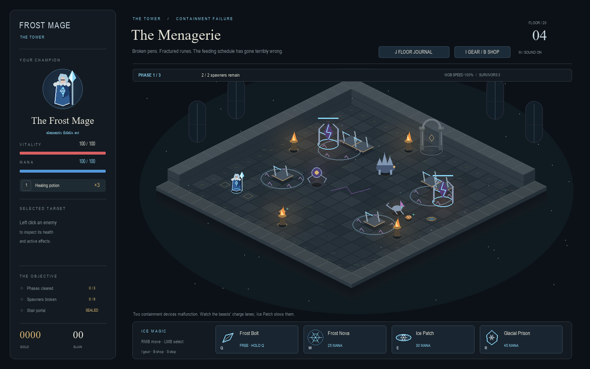
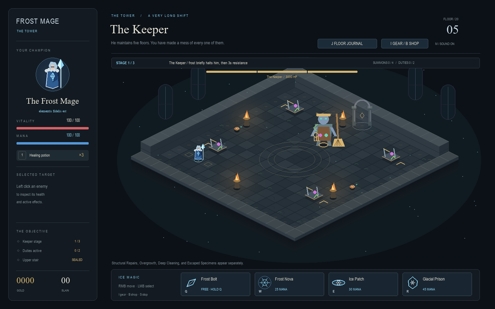
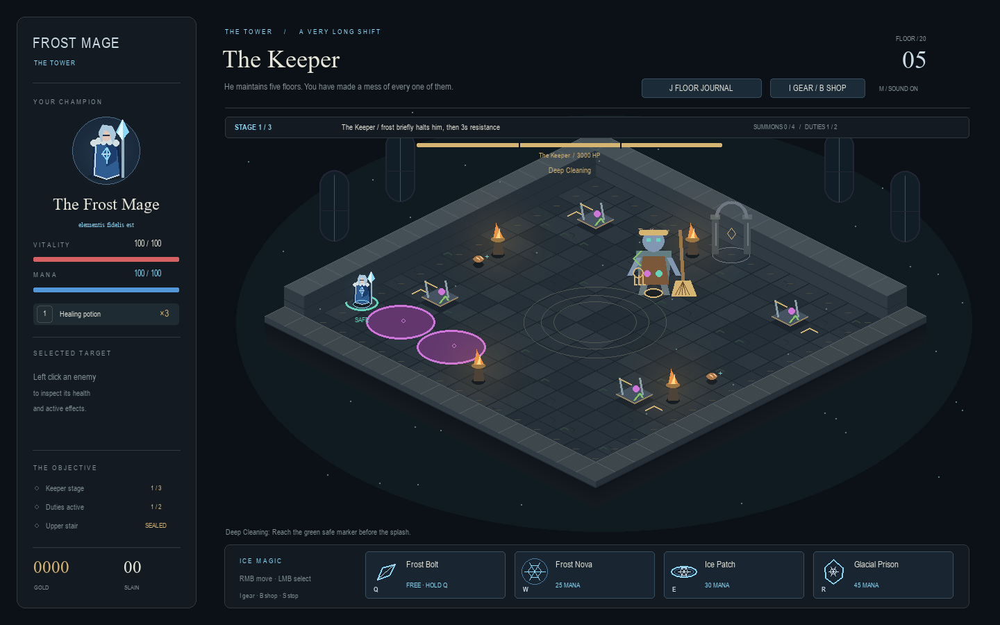

# The Menagerie and the Keeper

Floors 4 and 5 complete the first section of the twenty-story Tower. The Keeper
is an enchanted caretaker, not the tower's owner or the mountain wizard. The
existing Drearamore story, floors 1–3, controls, economy and equipment remain.

## Encounters

The Menagerie has broken pens, containment runes and feeding bowls, with low
scenery that leaves combat visible. Its containment devices follow the requested
2/3/4 waves, three-second intermissions, and 100/115/130% birth-phase speeds.
Nine devices open the portal; ordinary survivors remain optional. Loot does not
expire at wave or floor completion. The population cap is 14.

| Creature | Warning and attack | Counter and recovery |
| --- | --- | --- |
| Crystalback Beast | 1.05s locked lane, then a straight charge | Dodge sideways; Ice Patch slows it; terrain stops it for 1.6s |
| Runeclaw Prowler | 0.8s crouch/lane, then a short pounce | Sidestep; 1.1s recovery; at most two lunges telegraphed together |
| Arcane Drifter | 0.95s aim, then a 3.2 tiles/s orb | Dodge or use terrain cover; 0.9s recovery |

Freeze interrupts all three; ordinary enemies retain full freeze durations.
Chill slows specimen movement and lunges. The Keeper recalls the same specimens.

The Keeper is a large maintenance construct with a broom, keys, flasks and vines.
He remains damageable throughout the encounter. Defeating him, rather than
destroying spawners, completes the floor.

| Duty | Effect |
| --- | --- |
| Structural Repairs | A warned stone line erupts progressively; step sideways |
| Overgrowth | Warned, disjoint vine patches slow movement to 55%; expire after 7s |
| Deep Cleaning | A thrown potion marks up to three pools, then spills for 3.5s; green safe floor remains visible |
| Escaped Specimens | Small warned groups; strict global cap of four living summons; recall after 20s |

Stage 1 separates duties. Stage 2 pairs Repairs/Overgrowth or Cleaning/Specimens.
Stage 3 permits additional combinations after safety checks. Active warnings,
spills, vines and living summons count toward the limit of two major mechanics;
finishing a cast does not free its slot. Summons never shield the boss.

Each Keeper rotation gives all four duties a turn before repeating any duty.
If the next unused duty cannot safely fit, he waits for a slot rather than
repeating Repairs/Overgrowth. A cancelled warning remains due; specimens only
complete their turn when at least one creature actually appears.

Floors 1–3 mini bosses begin their first signature warning after 1s (previously
3s). Their full warning durations, seven-second repeat timers, recovery and
freeze interruptions remain intact. Ice Patch still slows their attack clocks.

## Fairness and tuning

Editable values live in `dungeon/keeper.py`, in `KeeperTuning`/`TUNING`.

| Value | Initial tuning |
| --- | --- |
| Fixed health | 3,000; no healing or extra health at stage changes |
| Stage thresholds | 2/3 and 1/3 health |
| Minimum warning / maximum accepted route budget | 2s / 5s |
| Reaction margin | 0.8s, plus remaining spell cast/stasis time |
| First Keeper warning | 1.5s into the encounter (previously 2.5s) |
| Scheduling intervals | 3.2s / 2.8s / 2.2s; persistent mechanics can delay casts |
| Damage before armor | Stone 22; spill 12 per contact, respecting ordinary hit immunity |
| Boss freeze cap / resistance | 0.45s / 3s from application |
| Nova vine suppression | 4s in Nova range; then regrow only if lifetime remains |
| Completion reward | 2,500 gold plus a Rank 3 helm, once per encounter |

Dijkstra escape planning uses actual movement speed, continuous terrain
clearance, enemy occupancy, locked specimen attack lanes, other
damage mechanics and projected vine slow costs. Safe markers include body
clearance. Warnings recheck their routes every 0.25s; blocked routes are replanned
with time to react, or the mechanic is cancelled. Uncertifiable combinations
are delayed. Escape never assumes an available spell or cooldown. Vines slow
rather than creating permanent walls. Ordinary right-click navigation still
follows terrain; the displayed safe route may require following its bends.

This is a conservative route check against the current arena and telegraphed
motion, not a proof against every future player/enemy action. Human balance and
fun still need playtesting.

## Progression and saves

Version-1 saves and the original local save location remain supported. Optional
`cleared_floor` and `lower_tower_completed` fields record Keeper victory. The
reward and completion marker are written atomically in the same save, and a
Keeper loot event requests an immediate save. Loading a defeated room restores
its cleared state without paying again. Explicit floor selection starts a new
encounter and can earn its reward again, matching replay rewards on other floors.

Death clears mechanics, summons and hostile projectiles. Retry, replay and
leaving an unfinished Keeper encounter for the title create fresh boss state.
Floors 1–3 retain their existing menu behavior. After victory, the upper stair
is visibly sealed; approaching it shows the section ending. Floor 6 is not
loaded, and the story explicitly continues for fifteen more floors.

## Validation

All 219 regression tests pass, including the Ice Patch behavior and damage tests. The suite includes Menagerie phases, roster limits, warning timing,
locked charges, pounces, wall-blocked orbs, freeze interruption, Keeper
thresholds, persistent-mechanic accounting, summon cap/recall, damageability,
hazard expiry, Nova suppression, crowd-control resistance, safe routes around
walls/vines/enemies, corner escape routes, changed geometry, death cleanup,
portal transitions, immediate saving, legacy saves and replay rewards. Finishing
the Keeper with Glacial Prison or Frost Nova while summons are in the blast
revalidates each target after victory recalls the summons, preventing stale
hits and duplicate removals. The desktop regression checks the complete
Glacial Prison finish, reward save and cleared-room reload.

Run with:

```powershell
.venv/Scripts/python.exe -m unittest discover -s tests -q
.venv/Scripts/python.exe tools/lower_tower_playtest.py
```

The deterministic combat bot uses rank-3 Frostweave equipment, ordinary health,
damage, mana, potions and cooldowns, uses Ice Patch, and reads attack telegraphs/green routes.
It casts spells and moves; it does not directly kill targets or use invincibility.
Seeds 3, 7, 19 and 41 each cleared both floors. With Ice Patch in use, Menagerie clears took 38.9–45.0s;
Keeper clears took 22.5–24.0s. Every Keeper run visited all three stages and used all four
duties. No run exceeded two major mechanics or four living summons.
Detailed results are in `lower-tower-playtest.json`.

Normal-speed manual gameplay was attempted with an isolated profile but the
desktop input session was interrupted; a complete manual combat review was
not performed. Automated wins do not establish that the fight is fun or balanced
for a human. For a visible normal-speed scripted run, use:

```powershell
.venv/Scripts/python.exe tools/lower_tower_playtest.py --realtime --seeds 7
```

## Screenshots






