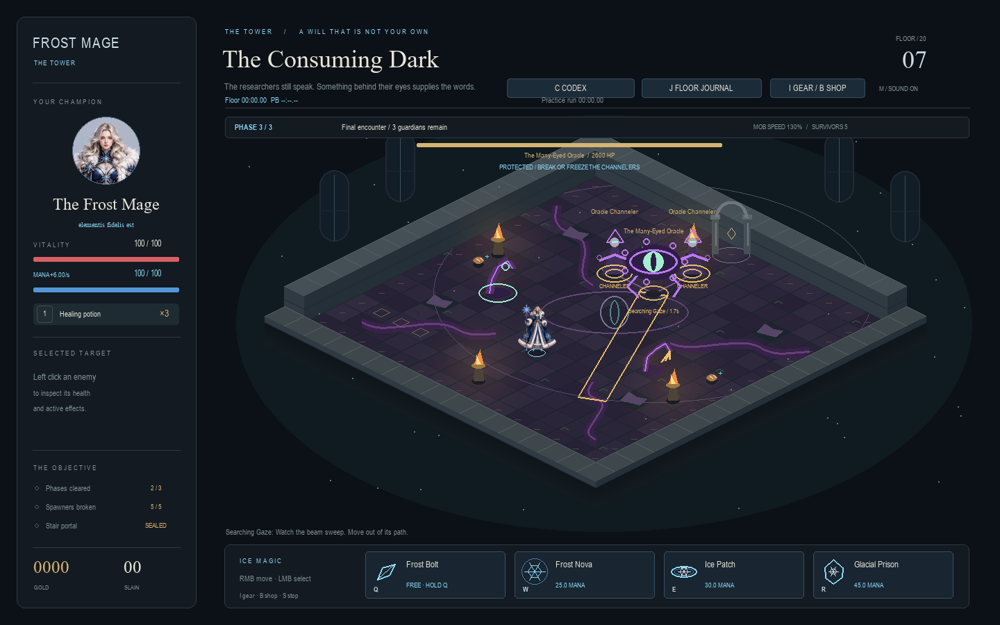
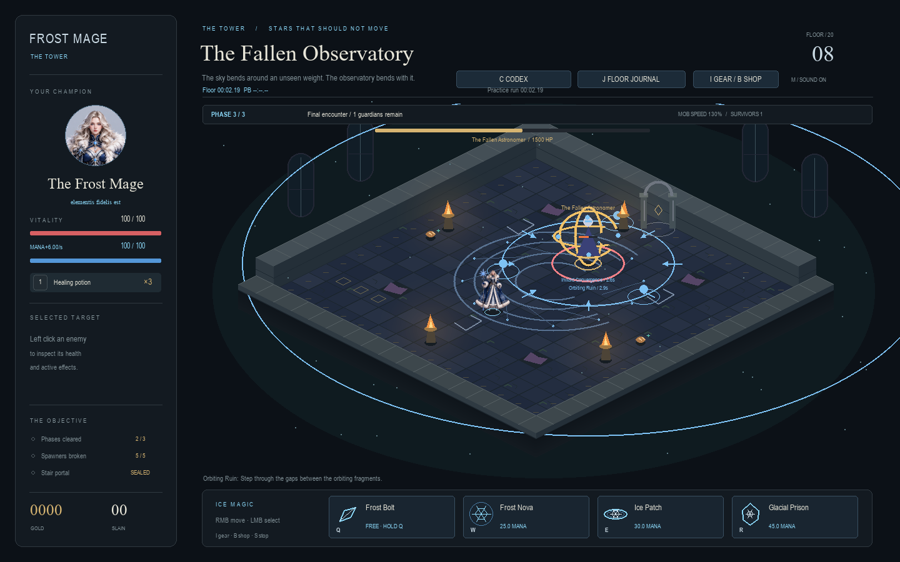

# Floors 7 and 8

The Arcanist's failed containment has become possession, then a distortion of
the observatory itself. These floors continue the Keeper/Arcanist story from
Floor 6. Floor 8 now leads into Floor 9's time puzzle, documented in
[The Fractured Hour](VOID_FLOOR_9.md), followed by the final void creature in
[The Maw Between Worlds](VOID_FLOOR_10.md).

## Shared rules

Both floors have two seal/focus spawners, a three-second intermission, three
spawners, another intermission, and an authored boss encounter. Ordinary surviving
enemies are optional after the boss falls. Loot remains collectible and is banked
on stair entry. Entering each floor unlocks it in Level Select; floors 7–8 use
its second page.

The shared `VoidDepths` controller extends Floor 6's expiring darkness and
safe boss placements. `VoidMechanic` handles locked circles/lanes, beams,
summon warnings, orbiting hazards and force fields. At most three mechanics
and one force field may be scheduled at once, including their warning periods.
Grasps and force fields exclude one another. Wave spawning reserves three
arrival slots under a total population cap of 12. New enemies use normal
health scaling, loot, frost, Ice Patch and spell damage rules.

Forces use the world's swept wall collision and cannot push the player through
terrain or off the floor. Normal movement can overcome attraction fields.
Glacial Prison prevents force displacement and normal hazard damage; neither
floor requires R. Frozen casters lose pending warnings. Released stars and
darkness keep their remaining lifetime after the caster dies. Darkness still
has Floor 6's shared cap of four separated pools and entry grace period.

## Floor 7 — The Consuming Dark

| Enemy | Behavior and counter |
| --- | --- |
| Lashing Tentacle | Locks a seven-tile lane for 1.4s, then strikes for 16 damage. Sidestep or freeze it. |
| Grasping Tentacle | Marks a 0.75-tile circle for 1.5s. A successful hit deals 8 damage and roots for up to 2.2s. Move out before impact or attack/freeze the source to escape. |
| Anchor Tentacle | Warns for 1.6s, then pulls at 0.9 tiles/s for four seconds toward its darkness. Destroy or freeze it to end the pull. |
| Enthralled Wizard | Locks aim for 0.95s, then fires a slow arcane bolt. Dodge, use cover, or freeze the cast. |

Grasps restrict movement orders only. Q/W/E/R and potions remain usable under
their normal resource and cooldown rules. The grasping limb is selected and
marked with a visible tether. The root also ends when its source dies, freezes,
is recalled, or its timer expires. Mind control affects the enemy wizards only.

The **Many-Eyed Oracle** has 2,600 HP. Two Oracle Channelers initially protect
it, reducing incoming damage by 80% while alive, unfrozen and within eight tiles.
Freezing both exposes a brief damage opportunity; killing them exposes the boss
until a later health-stage communion. Channelers expire after 24s and cannot
accumulate beyond two. At two-thirds and one-third health, an exposed Oracle
can warn a new pair into the arena. Occupied arrival points cancel the arrival.

Its attack rotation contains Searching Gaze (a warned, sweeping beam), Grasping
Chorus (three staggered strike circles), and Draw into Darkness (a warned,
attackable anchor summon). At most two summoned anchors can remain alive.
The gaze is cancelled during a grasp; lash/chorus warnings wait and preserve
a reaction window. Recovery follows the final part of a boss pattern and grants
the normal 35% bonus incoming damage. Boss freezes cap at 0.55s, followed by
3.5s of freeze resistance.

## Floor 8 — The Fallen Observatory

| Enemy | Behavior and counter |
| --- | --- |
| Gravity Adept | Marks an attraction well at the player's position. After 1.6s it pulls at 0.85 tiles/s for 2.4s, then its 1.3-tile core explodes for 22 damage. Leave the circle. |
| Repulsion Construct | Warns for 1.6s, then pushes outward at 1.5 tiles/s for 0.8s inside five tiles. Move inward or leave its radius. |
| Orbiting Fragment | Follows a fixed 1.4-tile orbit and deals 14 contact damage. Ice Patch and chill slow its orbit; freeze stops it. |

The **Fallen Astronomer** has 2,800 HP and remains stationary inside a shattered
celestial instrument. Its rotation is:

1. **Inward Convergence:** a 1.8s warning, then a three-second pull at 1.35
   tiles/s. The central 1.5-tile danger zone deals 18 damage. Move outward early.
2. **Stellar Rejection:** a 1.8s warning, then a 1.2s outward pulse at 2.2
   tiles/s. Position inward during the warning. Walls stop displacement.
3. **Orbiting Ruin:** warns a 3.5-tile orbit, then three fragments circle for
   4.5s. Avoid their marked footprints and pass through gaps.
4. **Collapsing Star:** marks the player's position, warns for 1.8s, then pulls
   locally for 2.5s before its core detonates. The final 0.8s highlights the core.

Below two-thirds health, pull/push patterns may share the arena with one orbit.
They still use a single force slot. The final pattern's end starts at least a
1.3s recovery interval before another major pattern. Ice Patch slows the
Astronomer's warning/cooldown clocks; brief freezes interrupt pending patterns
and trigger the shared void-boss resistance window. Active fields are visible
and continue their remaining lifetime.

## Saves and validation

Live checkpoints preserve root source/time, warning clocks, force centers,
orbit progress, channeler references, summons and boss scheduling. Victory or
death clears active mechanics and recalls summons. Player death wins if player
and boss die in the same tick. Loading an old completed Floor 6 checkpoint now
permits continuation to Floor 7, without rewriting the slot on read.

The Floors 7–8 release passed 408 tests. `tests/test_void_depths.py` covers progression,
grab counterplay, channeler protection, frost interruption, field limits,
wall-safe gravity, Prison resistance, normal-movement escape, orbit slowing,
neutral intervals, cleanup, same-tick death, live-state roundtrips, old terminal
checkpoints and Codex values.

`tools/void_depths_playtest.py` completed twelve normal-resource runs: three
seeds per floor with a Keeper crown plus Rank 2 ordinary gear, and three with
full Rank 3 Frostweave. No direct kills, invulnerability, or R casts were used.
All runs cleared, taking approximately 44–62 seconds on Floor 7 and 43–56
seconds on Floor 8. Caps held throughout: at most three mechanics and one force
field. Results are in `void-depths-playtest.json`. The bot reads warning geometry
directly; these results verify completion and resource pressure, not human
difficulty or final balance.
