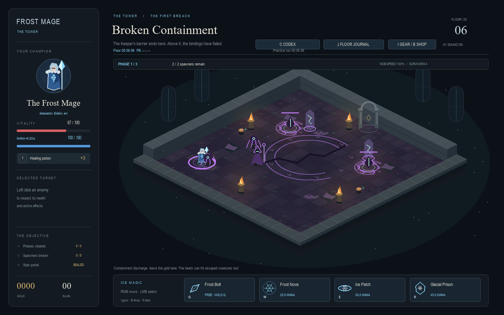
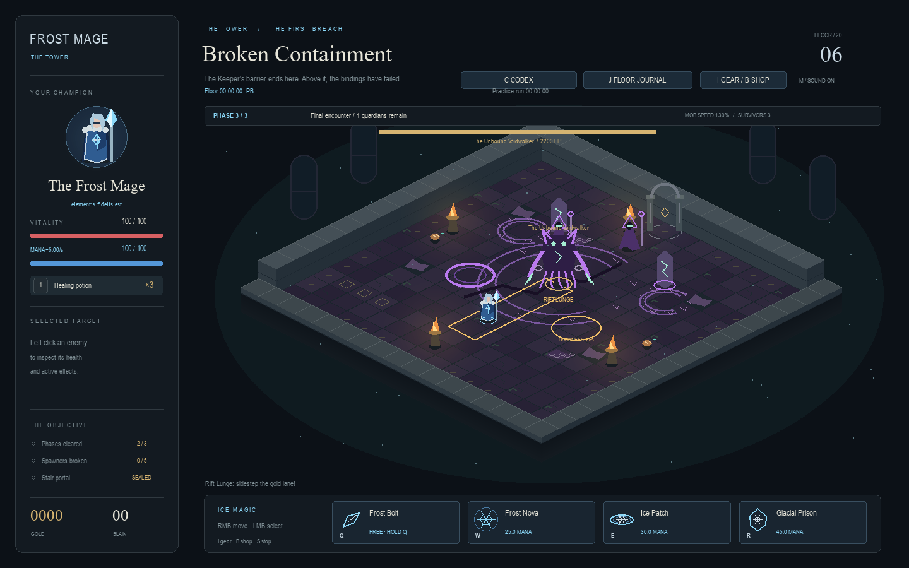
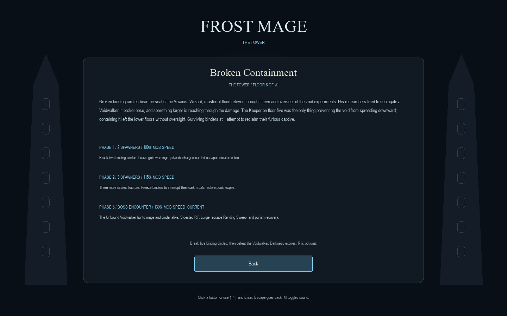

# Floor 6 — Broken Containment

Floor 6 begins the void arc. Floors 7 and 8 continue it with the Oracle and
Astronomer; see [their encounter notes](VOID_FLOORS_7_8.md). Floors 9–10 are future work.
The Arcanist Wizard rules floors 11–15 and oversaw the failed experiments.
The Keeper was the only barrier preventing the void from spreading downward;
his containment work left the lower floors without oversight.

## Progression

Two fractured binding circles, a three-second intermission, three more circles,
another intermission, then the Unbound Voidwalker and two surviving binders.
Phase birth speeds retain the existing 100/115/130% progression. The boss must
die to open the final stair; surviving ordinary enemies are optional. Remaining
gold and gear are collected on stair entry. The stair now leads to Floor 7,
The Consuming Dark. Old terminal Floor 6 checkpoints can continue through it.

The Keeper's existing reward and lower-tower achievement remain on Floor 5.
Entering Floor 6 unlocks it in Level Select. Old live snapshots ending on
Floor 5 now allow continuation through the stair. No save slots are rewritten
merely by loading them.

## Enemies and hazards

| Threat | Warning and behavior | Counterplay |
| --- | --- | --- |
| Escaped Voidling | 56 HP on Floor 6; pursues and claws for 13 damage before armor | Kite, chill, freeze and use Ice Patch |
| Void Binder | 84 HP; marks a one-tile darkness circle at the player's current position; 1.5s warning and 5.5s cooldown | Leave the ring or freeze the caster before release |
| Darkness | Four-second lifetime; 10 damage through the normal hit protection rules after 0.35s continuous exposure | Move out; Prison prevents damage; released pools persist after the caster dies |
| Containment discharge | First at 5s, then every 8s during waves; 1.6s warning; fixed lane, clipped by terrain | Sidestep; lure escaped creatures into it for 30 environmental damage; player damage is 18 |

The same ground-zone type supports circles, line warnings, environmental pulses,
and warned summon locations. Active darkness has a shared cap of four; circles
must have at least 0.6 tiles between their edges and clear terrain around them.
These separated patches preserve lanes in the authored open room. Entry grace
resets on leaving a field. Pools do not stack damage through the player's shared
0.65s hit protection. A committed Prison extends a newly placed pool's warning.

Wave spawning caps at nine actors to reserve three boss arrival positions;
the total encounter cap is 12. Wave binders cap at three. Boss summons cap at
four, expire after 18s, and require clear terrain and distance from actors at
the end of their warning. Walking into a summon warning cancels that arrival.
Early discharge warnings end when the boss phase begins.

## The Unbound Voidwalker

The boss has 2,200 HP and targets the nearest visible mage or binder. Attacks
can damage binders without inheriting player gear bonuses or critical hits.
A single attack hits each binder at most once.

| Attack | Rule |
| --- | --- |
| Rift Lunge | Direction locks during a 1.2s warning; travels up to 5.5 tiles at 7 tiles/s; 24 damage; swept collision stops at walls |
| Rending Sweep | Front-facing fan of radius 2.4 tiles with a 1.3s warning; 20 damage; walls block damage |
| Void Scar | From the second health stage, a completed lunge can leave a small, warned darkness patch; lifetime 3.5s; shares the pool cap |
| Shatter the Chains | At two-thirds and one-third health, breaks one pillar after a 1.6s warning, marks two summon locations, and leaves a temporary warned pool by the broken pillar |

Skipping a health threshold still schedules both pillar breaks in order.
Freeze can interrupt and delay them. All spells continue to deal damage during
freeze resistance. Freeze lasts at most 0.55s, followed by 3.5s of resistance.
Ice Patch slows attack clocks and lunges; chill slows movement and lunges.
Recovery grants 35% extra incoming damage; the final stage shortens the recovery
after sweeps and pillar breaks. Glacial Prison is optional throughout this floor.

Victory and death clear warnings, darkness and summons. Player death takes
precedence if the player and boss die in the same simulation tick. Replaying or
retrying starts a fresh encounter; loading a live checkpoint restores the exact
warnings, timers, actor references, zones, pillar progress and random state.

## Validation

`tests/test_void.py` covers progression, scope, caps, environmental damage,
locked lunges, sweep geometry, interruption/resistance, Ice Patch, darkness
grace/expiry, summon placement, threshold skips, same-tick death, older Floor 5
snapshots, Floor 6 save slots, Codex values and deterministic continuation.

`tools/void_playtest.py` runs three seeds with a full Rank 3 Frostweave set and
three with a Rank 3 Keeper crown plus Rank 2 ordinary equipment. It uses normal
spells, movement, resources and cooldowns, with no direct kills or Prison casts.
All six runs completed (approximately 34–49 seconds). Results are recorded in
`void-playtest.json`. The bot reads warning geometry directly; these runs verify
completion and resource use, and do not establish human difficulty or final balance.

